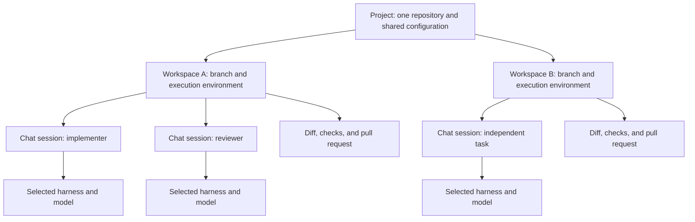

# Conductor agent orchestration

Conductor organizes agent work around projects, workspaces, and chat sessions. It manages the development environment and review workflow. Each selected agent harness runs the reasoning and tool calls. A harness is the runtime that operates an agent. [Harness overview](https://www.conductor.build/docs/reference/harnesses)

## Study scope and approach

This study examines the documented architecture and control interfaces of the Conductor app. It focuses on agent organization, isolation, context, supervision, and integration. Status: complete for public documentation research as of October 12, 2026. Internal implementation details remain open questions.

The research uses official Conductor documentation, its public OpenAPI specification, and read-only inspection of bundled files. OpenAPI describes the requests and responses of an HTTP API. The installed Mac app reports version `0.90.1`. Live documentation can describe features beyond that installed version.

No authenticated API calls, agent launches, workspace creation, or application configuration changes formed part of this study. The study did not inspect private transcripts or credentials. See [sources.md](sources.md) for evidence and [api-observations.json](api-observations.json) for a focused snapshot of the public API contract.

## The organization model

A project represents one repository, its configuration, and its workspaces. A workspace owns a branch, working files, running processes, and review state. A Git worktree is a separate checkout of one repository. Conductor uses worktrees for local workspace isolation. [Isolated workspaces](https://www.conductor.build/docs/concepts/workspaces-and-branches)

Each workspace supports multiple chat sessions. Each chat selects one harness and one model. Separate chats in the same workspace share its current files and branch. [Harness overview](https://www.conductor.build/docs/reference/harnesses)

This diagram describes ownership and scope. It does not assert an internal process tree or database schema. The API exposes distinct workspace and session identifiers, which support this distinction. [API contract](https://api.conductor.build/v0/openapi.json)

## How responsibilities divide

| Layer | Responsibility | Scope |
| --- | --- | --- |
| Conductor | Organize repositories, workspaces, chats, terminals, diffs, checks, and pull requests | Across tasks |
| Workspace | Hold the branch, files, development processes, and review state | One stream of work |
| Chat session | Hold a conversation and its selected harness and model | One agent thread |
| Harness | Run the agent loop and tool calls | One agent execution context |
| Model | Produce language and coding output | Through the selected harness |

Conductor documents Claude Code, Codex, Cursor, and OpenCode as supported harnesses. It bundles managed executables for Claude Code, Codex, and OpenCode. Cursor sessions use Cursor Agent through the Cursor API. [Harness overview](https://www.conductor.build/docs/reference/harnesses)

This means a multi-agent feature inside a harness belongs to a different layer from Conductor workspace management. The reviewed documentation does not establish one universal Conductor scheduler for every harness. It also does not establish automatic assignment of every task to specialist agents. These are limits of the available evidence.

## Two forms of parallel work

Independent tasks use separate workspaces. Each receives its own branch, files, processes, and path to review. Examples include separate features, issue investigations, and experiments. Shared tasks use multiple chats within one workspace. Examples include implementation, review, and test repair on the same branch. [Parallel agents](https://www.conductor.build/docs/concepts/parallel-agents)

| Task relationship | Organization | Coordination cost |
| --- | --- | --- |
| Tasks can ship independently | Separate workspaces | Integrate branches and resolve merge conflicts |
| Tasks need current shared code | Multiple chats in one workspace | Coordinate edits to shared files |
| Alternative approaches can diverge | Separate workspaces | Select a result and transfer useful context |

The isolation boundary therefore follows the work that must ship together. It does not follow the number of agents. Agents in one workspace can overwrite each other's edits because their working files are shared. [Parallel agents](https://www.conductor.build/docs/concepts/parallel-agents)

## Context and instructions

Repository configuration supplies recurring instructions for general work, code review, PR creation, error repair, conflict resolution, and branch naming. Instruction files such as `AGENTS.md` and `CLAUDE.md` supply durable project guidance. Task details belong in chats, attachments, and the workspace `.context` directory. [Agent behavior](https://www.conductor.build/docs/reference/agent-behavior)

Shared files do not imply shared conversation memory. The API delegation examples require a self-contained brief because implementing sessions do not inherit the manager's conversation. A manager must communicate interfaces, constraints, and completion criteria explicitly. [Conductor API](https://www.conductor.build/docs/api)

Conductor uses the MCP configuration of the selected harness. MCP connects agents to external tools and data. Conductor does not introduce a separate configuration format for those integrations. Its UI can report discovered configuration before a session starts and running MCP status afterward. [MCP reference](https://www.conductor.build/docs/reference/mcp)

## Environment and process management

Project scripts prepare, run, and clean up workspaces. Setup runs after creation. Run scripts start through the Run control. Archive scripts clean up resources before archive. Local workspaces receive ten allocated ports. Concurrent run mode permits overlapping run scripts. Nonconcurrent mode stops another run script before starting the requested one. This control governs project processes, not a general agent concurrency limit. [Scripts](https://www.conductor.build/docs/reference/scripts)

Local worktrees isolate development files. They do not restrict agents to a security sandbox. Local agents operate with the access of the Mac user account, subject to configured controls. Cloud agents run in isolated Linux sandboxes. [Security and permissions](https://www.conductor.build/docs/reference/security-and-permissions)

Cloud adds an organization and a shared Cloud Computer. The Cloud Computer defines repositories, software, secrets, and environment configuration. New cloud workspaces start from its active successful build. Existing workspaces retain the environment from their creation. Multiple chats can operate against one workspace's files. The workspace is therefore the useful environment boundary even when several agents participate. [Conductor Cloud](https://www.conductor.build/docs/cloud), [Multiplayer](https://www.conductor.build/docs/cloud/collaboration)

Cloud files and transcripts survive sleep, but processes do not. The documented maximum sandbox lifetime can interrupt active turns. Persistent workspace records therefore do not guarantee uninterrupted execution of an agent. [Cloud workspace operations](https://www.conductor.build/docs/cloud/working-with-cloud-workspaces)

## Programmatic agent supervision

The documented local workflow uses the app to create and control workspaces. The bundled skill says local workspaces have no management CLI or API. The cloud API exposes programmatic management of projects, workspaces, sessions, and messages. Its hosted MCP server exposes similar operations to external agent clients. [Conductor API](https://www.conductor.build/docs/api), [Conductor MCP server](https://www.conductor.build/docs/api/mcp)

An external manager can create workspaces, start sessions, send briefs, inspect transcripts, and cancel turns. The API guide demonstrates manager and worker patterns. The manager supplies task decomposition and supervision through these interfaces. Conductor supplies the execution and observation facilities. The reviewed sources do not establish that every ordinary chat automatically receives a manager. [Conductor API](https://www.conductor.build/docs/api)

The public contract exposes separate kinds of state:

| Object | Observed contract values | Meaning |
| --- | --- | --- |
| Workspace | `unstarted`, `initializing`, `ready`, `sleeping`, `updating`, `archived`, `deleted` | Environment lifecycle |
| Session | `idle`, `working`, `error` | Agent activity |
| Submitted message | `queued`, `sent` | Delivery state |

These values come from the live [OpenAPI specification](https://api.conductor.build/v0/openapi.json). They are values, not a complete specification of allowed transitions. The human API guide uses “errored” in one description, while the contract uses `error`. A client must follow the contract.

The API guide explains that a session can remain idle before Conductor delivers its queued brief. A manager must observe execution or a reply before treating idle as completion. Follow-up messages can steer ongoing work. Transcript polling supports an `after` message cursor. [Conductor API](https://www.conductor.build/docs/api)

The contract also distinguishes retry behavior. Workspace creation is not idempotent, which means repeating it can create another workspace. Session creation supports caller-supplied identifiers for retry handling. Cancellation finishes asynchronously and drops queued messages. These details matter when implementing a reliable manager. [OpenAPI specification](https://api.conductor.build/v0/openapi.json)

Routines provide another launch path. A routine stores a prompt and starts a fresh cloud workspace when its trigger fires. The API documents webhook creation and existing routines with cron or GitHub triggers. This supplies automation without establishing a universal dependency scheduler. [Conductor API](https://www.conductor.build/docs/api)

## Review, recovery, and integration

The documented workflow integrates work through branches and pull requests. An agent implements a scoped task, the user or another agent reviews the diff, and feedback returns to the implementing agent. Completed branches merge independently. Archiving removes finished workspaces from active work and preserves a restoration path. [Workflow](https://www.conductor.build/docs/concepts/workflow)

The Checks panel collects Git status, CI results, deployments, comments, and todos. Todos represent unfinished work before merge. Merge controls can block or discourage integration when relevant work remains open. These controls concern review readiness, rather than proving that an agent completed its assigned task. [Checks](https://www.conductor.build/docs/reference/checks), [Todos](https://www.conductor.build/docs/reference/todos)

Checkpoints capture code state before supported agent responses. They use private Git references outside normal branch history. Restoring also removes the selected conversation turn and later turns. Multiple chats share workspace files, so restoring one checkpoint can affect another agent's edits. [Checkpoints](https://www.conductor.build/docs/reference/checkpoints)

The installed `checkpointer.sh` corroborates this mechanism. It stores references under `refs/conductor-checkpoints/<id>` and records HEAD, staged state, and working files. Capture uses a temporary index and leaves HEAD unchanged. The study only read this script. It did not invoke capture or restoration. See the local evidence entries in [sources.md](sources.md).

## Implications for a browser-agent design

These are design inferences from Conductor's documented model. They are not claims about Conductor browser automation. A browser task can use the same distinction between an isolated execution environment and individual conversations. The browser equivalent must define its own boundaries for tabs, cookies, accounts, and shared page state.

Useful design lessons include:

1. Separate the task environment from the agent conversation.
2. Track environment readiness, agent activity, message delivery, and acceptance as different states.
3. Give delegated workers explicit briefs instead of assuming inherited memory.
4. Match isolation to tasks that need independent completion and review.
5. Make recovery scope clear when agents share mutable state.
6. Expose controls for supervision and retain evidence for acceptance.

## Remaining questions

The public sources establish the organization model and external controls. They do not disclose the full desktop or cloud implementation. The following questions require source access, developer confirmation, or a separate controlled experiment:

- Which internal protocols connect Conductor to each harness?
- How do internal queues handle priority, backpressure, and concurrent turns?
- Which locks coordinate file writes or checkpoint restoration across shared chats?
- How does Conductor resume harness state after crashes or sandbox replacement?
- Which internal data stores hold sessions, transcripts, and workflow state?
- How does Conductor combine harness-native child agents with its own session accounting?

No authenticated behavioral experiment formed part of this study. API documentation establishes advertised behavior and contracts, rather than proof of every runtime edge case.
